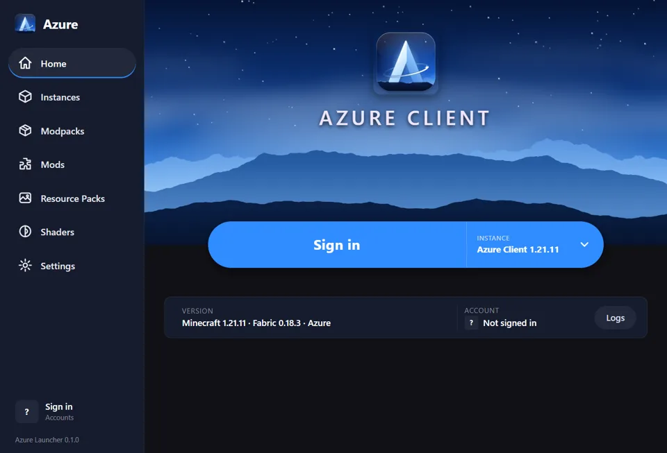
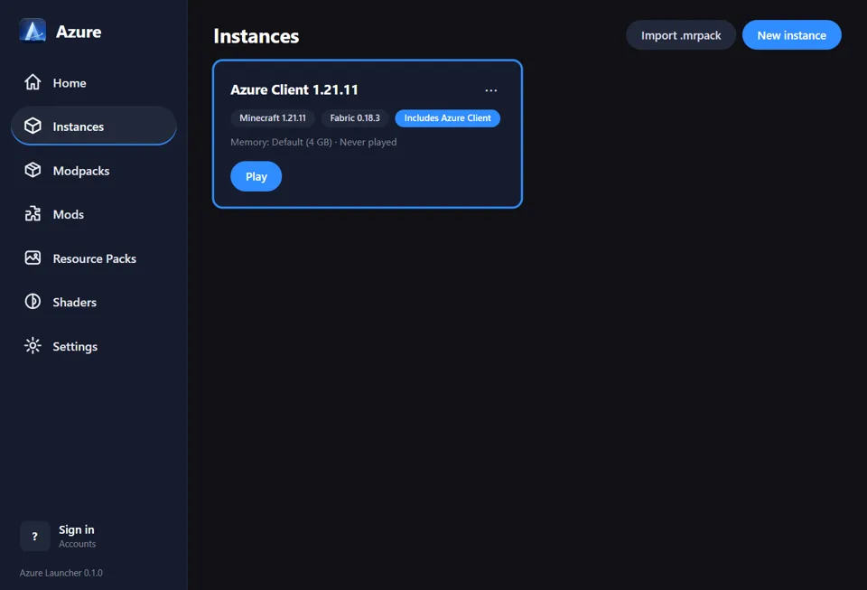
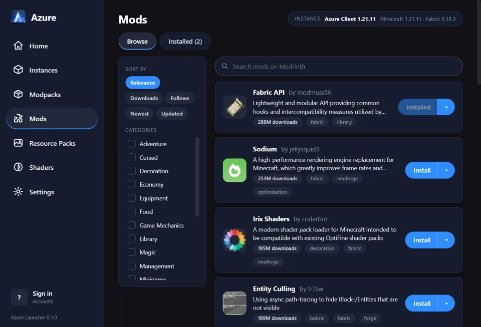

# Azure Launcher

A free launcher for **Minecraft: Java Edition** that sets up and starts [Azure Client](https://azureclient.pages.dev), a Fabric client mod for Minecraft 1.21.11.

It installs Minecraft, Fabric and Azure Client for you, keeps Azure Client and your mods up to date, and lets you add mods, resource packs and shaders from Modrinth. Before every start it checks your mods and explains anything that won't work, with one-click fixes.

| Home | Instances | Mods |
| --- | --- | --- |
|  |  |  |

## What you need

- **Windows 10 or 11 (64-bit).** There is no Mac or Linux version yet.
- **A Microsoft account that owns Minecraft: Java Edition.** You sign in on Microsoft's own page; the launcher never sees your password. It checks that your account owns the game, and there is no offline mode: you can't play without an account that owns it.

## Download

1. Open the [latest release](https://github.com/sabripro6901-debug/azure-launcher/releases/latest).
2. Under **Assets**, download `Azure-Launcher-Setup-<version>.exe`.
3. Run it and follow the installer.

The launcher updates itself after that: when a new version is out, it installs it quietly the next time nothing is running.

### "Windows protected your PC"

The installer isn't code-signed yet, so Windows SmartScreen may show a blue **Windows protected your PC** window the first time. Click **More info** (it says *Unknown publisher*, because the file isn't signed), then **Run anyway**. Only download the installer from this repository's Releases page or from [azureclient.pages.dev](https://azureclient.pages.dev/download.html#launcher).

## Privacy

- Your sign-in tokens (Microsoft, Xbox and Minecraft) are encrypted with Windows' secure storage and stay on your PC. They are never sent to our servers and never written to logs.
- The launcher talks to Microsoft and the Xbox and Minecraft sign-in services (to sign you in), Mojang (game files, Java runtime and your skin head), Fabric (loader versions), Modrinth (the mods, packs and shaders you choose, and file hashes when the mod check looks up the right version of a mod), our public update channel (the signed Azure Client build) and GitHub (launcher updates).
- No analytics, no ads, no usage data.

Full details: [azureclient.pages.dev/privacy](https://azureclient.pages.dev/privacy.html#launcher).

## Not an official Minecraft product

Azure Launcher is not an official Minecraft product. It is not approved by or associated with Mojang or Microsoft. "Minecraft" is a trademark of Mojang Synergies AB. Minecraft's own files are downloaded from Mojang's servers; nothing of the game is included here.

## Publisher

Made by **Sabrilbg** (a private individual).
Contact: sabripro6901@gmail.com · Website: [azureclient.pages.dev](https://azureclient.pages.dev)

For building from source, see [RELEASE.md](RELEASE.md).
